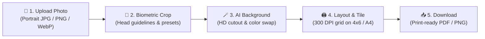

# 📸 Photolizer (PhotoForge AI)

> **All-in-One AI Passport Photo Studio & Print-Ready Layout Suite.**  
> Transform ordinary smartphone portraits into certified, biometric-compliant passport photos and print-ready tiled photo sheets in seconds.

[](https://nextjs.org/)
[](https://react.dev/)
[](https://www.typescriptlang.org/)
[](https://tailwindcss.com/)
[](https://sharp.pixelplumbing.com/)
[](https://pdf-lib.js.org/)
[](LICENSE)
[](https://github.com/your-username/photolizer/pulls)

---

## 🌟 Overview

Getting passport photos shouldn't mean spending $15–$25 at a local pharmacy, fighting with clunky kiosks, or risking visa rejections due to non-compliant dimensions and backgrounds.

**Photolizer** brings professional studio capabilities directly into your browser. Upload any portrait from your phone or camera, align it against official biometric standards (ICAO / ISO / State Dept), remove and swap the background to official consular colors, and automatically tile high-resolution 300 DPI photo sheets onto standard **4×6"**, **5×7"**, **A4**, or **US Letter** paper.

Download as an **HD PNG** or **vector-accurate print-ready PDF** with built-in scissor cut guidelines, take it to any photo kiosk (CVS, Walgreens, Walmart, boots) or print at home for just a few cents!

---

## 🚀 Key Features

### ✂️ 1. Interactive Biometric Cropper & Alignment Assistant
- **Biometric Face Guides:** Real-time visual overlay displaying crown height, chin boundaries, and eye-level alignment markers matching official 70%–80% biometric facial coverage standards.
- **Intuitive Controls:** Smooth zoom slider, pan/drag positioning, and 90-degree lossless rotations to frame any angle perfectly.
- **Aspect Ratio Locking:** Automatically constrains crops to document standards (1:1, 35:45, 5:7, 33:48, etc.).

### 🪄 2. AI Background Removal & Official Palette Replacement
- **HD Edge Precision:** Preserves natural hair strands, sharp garment contours, and removes harsh shadows.
- **Consular Color Palette:** One-click swaps between official background requirements:
  - ⚪ **Pure White** (`#FFFFFF`) — US, India, Canada, Japan, Australia
  - 🍦 **Off-White / Cream** (`#F8F8F6`) — United Kingdom (HMPO)
  - 🔘 **Light Grey** (`#E2E8F0`) — European Schengen Visa, Australia
  - 🌊 **Passport Sky Blue** (`#38BDF8`) — Malaysia, Indonesia (odd years)
  - 🔴 **Consular Red** (`#EF4444`) — Indonesia (even years)
  - 🏁 **Transparent PNG** — For digital submissions & custom graphic design

### 🖨️ 3. Dynamic 300 DPI Tiling & Layout Engine
- **Physical Accuracy:** Exact millimeter-to-pixel rendering (`(mm / 25.4) * 300 DPI`) via native `sharp` image processing.
- **Supported Paper Formats:**
  - **4 × 6 in (10 × 15 cm)** — The universal photo print standard (pharmacy kiosks & home inkjet).
  - **5 × 7 in (13 × 18 cm)** — Medium studio portrait cards.
  - **A4 (210 × 297 mm)** — International document standard.
  - **US Letter (8.5 × 11 in)** — North American standard document sheet.
- **Customizable Layout:** Set custom quantities, photo dimensions, inter-photo gap spacing (mm), and sheet margins (mm).
- **Subtle Cutting Guides:** Automated thin scissor/trim guidelines drawn between photos for effortless manual cutting.

### 📄 4. Multi-Format High-Fidelity Exports
- **Print-Ready PDF:** Generated with `pdf-lib` containing embedded physical dimensions, preventing printer auto-scaling distortions.
- **High-Resolution PNG:** Full-size uncompressed graphic export for digital submission portals or desktop printing.
- **Direct Browser Print:** Native print dialog integration pre-configured for standard page media.

### 🔒 5. Privacy-First & Zero Data Retention
- **No Cloud Image Storage:** Photos are never saved on remote databases, S3 buckets, or permanent disks.
- **Ephemeral Processing:** Server-side transformations happen in memory buffers and are released immediately.
- **Client-Side Persistence:** Session state and processed photos are securely cached in your browser's local **IndexedDB** (`photolizer_db`) with transparent fallback to `sessionStorage`, safely handling massive multi-megabyte buffers without crashes.

---

## 🔄 How It Works



1. **Upload:** Drag and drop your portrait or selfie (up to 5MB).
2. **Crop & Align:** Select your target country preset. Align eyes and chin to the biometric overlay guidelines.
3. **Enhance:** AI removes distracting backgrounds and fills in official white/grey/blue backdrops.
4. **Configure Sheet:** Pick your paper size (e.g., 4x6" photo card), choose quantity, and inspect live layout metrics.
5. **Print & Cut:** Download the 300 DPI PDF or PNG, print at 100% scale, and cut along the guide lines!

---

## 🌍 Supported Country & Document Presets

Photolizer comes pre-loaded with official specifications for the world's most common passports, visas, and identification documents:

| Flag | Country / Region | Document Type | Dimensions (mm) | Aspect Ratio | Required Background |
|:---:|:---|:---|:---:|:---:|:---|
| 🇺🇸 | **United States** | Passport, Visa, Green Card | 50.8 × 50.8 mm (2×2 in) | 1:1 | Pure White |
| 🇬🇧 | **United Kingdom** | HMPO Passport & Driving Licence | 35 × 45 mm | 35:45 | Off-White / Cream |
| 🇪🇺 | **European Union** | Schengen Visa / EU Residency | 35 × 45 mm | 35:45 | Neutral Light Grey |
| 🇮🇳 | **India** | Passport & OCI Card | 35 × 45 mm | 35:45 | Pure White |
| 🇮🇳 | **India** | PAN Card / National ID | 25 × 35 mm | 25:35 | Pure White |
| 🇨🇦 | **Canada** | Passport & Citizenship | 50 × 70 mm | 5:7 | Pure White |
| 🇦🇺 | **Australia** | Australian Passport | 35 × 45 mm | 35:45 | White or Light Grey |
| 🇨🇳 | **China** | Passport & Entry Visa | 33 × 48 mm | 33:48 | Pure White |
| 🇯🇵 | **Japan** | Passport & Residence Card | 35 × 45 mm | 35:45 | Plain Light White |
| 🇲🇾 | **Malaysia** | Passport & Visa | 35 × 50 mm | 7:10 | Passport Sky Blue |
| 🇮🇩 | **Indonesia** | Passport & KTP ID | 35 × 45 mm | 35:45 | Consular Red / Blue |
| ⚙️ | **Custom** | Any Global ID / Badge / License | *Custom W × H* | *Custom* | *Any Choice* |

---

## 📊 Paper Sizes & Maximum Sheet Capacities

Below is the standard yield of passport photos fitting on various paper types (with standard margins and gaps):

| Paper Name | Dimensions (mm) | Dimensions (inches) | Standard 2×2" Photos | Standard 35×45mm Photos | Recommended Use Case |
|:---|:---:|:---:|:---:|:---:|:---|
| **4 × 6 in** *(Popular)* | 101.6 × 152.4 mm | 4.0 × 6.0 in | **2 – 6 photos** | **6 – 8 photos** | Local pharmacy kiosks (CVS/Walgreens), home photo printers |
| **5 × 7 in** | 127.0 × 177.8 mm | 5.0 × 7.0 in | **4 – 6 photos** | **8 – 12 photos** | Studio cards and photo labs |
| **A4 Sheet** | 210.0 × 297.0 mm | 8.27 × 11.69 in | **12 – 18 photos** | **24 – 35 photos** | International home / office laser & inkjet printing |
| **US Letter** | 215.9 × 279.4 mm | 8.5 × 11.0 in | **12 – 16 photos** | **20 – 30 photos** | North American office paper printing |

---

## 🛠️ Architecture & Tech Stack

```
┌────────────────────────────────────────────────────────┐
│                   Photolizer Client                    │
│  Next.js 16 (App Router) + React 19 + Tailwind CSS v4  │
│  Framer Motion • Lucide React • IndexedDB Cache Engine │
└──────────────────────────┬─────────────────────────────┘
                           │
           ┌───────────────┴───────────────┐
           ▼                               ▼
┌───────────────────────┐       ┌────────────────────────┐
│   Client Processing   │       │   Next.js API Routes   │
│ • Biometric Cropper   │       │ • /api/remove-bg       │
│ • Real-time Preview   │       │ • /api/generate-layout │
│ • Local Canvas Render │       │ • /api/export-pdf      │
└───────────────────────┘       └───────────┬────────────┘
                                            │
                           ┌────────────────┴───────────────┐
                           ▼                                ▼
                ┌─────────────────────┐          ┌──────────────────────┐
                │  Remove.bg Service  │          │  Sharp & PDF-Lib     │
                │  AI Edge Cutout     │          │  300 DPI Composition │
                └─────────────────────┘          └──────────────────────┘
```

- **Framework:** [Next.js 16](https://nextjs.org/) (App Router, Turbopack, React Server Components)
- **UI & Styling:** [React 19](https://react.dev/), [Tailwind CSS v4](https://tailwindcss.com/), [Framer Motion](https://motion.dev/), [Base UI](https://base-ui.com/)
- **Icons:** [Lucide React](https://lucide.dev/)
- **Image Processing Core:** [Sharp](https://sharp.pixelplumbing.com/) (Node.js high-performance C++ image processing library running at 300 DPI)
- **Document Generation:** [PDF-Lib](https://pdf-lib.js.org/) (Client & server vector PDF builder with exact millimeter dimensions)
- **Storage Layer:** Client-side **IndexedDB** (`photolizer_db`) with fallback to browser `sessionStorage`

---

## 📁 Project Directory Structure

```text
photolizer/
├── public/                     # Static assets & icons
├── src/
│   ├── app/
│   │   ├── api/
│   │   │   ├── export-pdf/       # POST: Generates print-ready vector PDF sheets
│   │   │   ├── generate-layout/  # POST: Sharp-based 300 DPI tiled layout generator
│   │   │   └── remove-bg/        # POST: AI-powered background removal route
│   │   ├── preview/              # Single photo inspection & backdrop color chooser
│   │   ├── print/                # Interactive print layout configuration & live preview
│   │   ├── upload/               # Drag-and-drop upload zone with trust indicators
│   │   ├── globals.css           # Tailwind CSS v4 styling & color tokens
│   │   ├── layout.tsx            # Root layout with fonts, metadata, Navbar & Footer
│   │   └── page.tsx              # Landing page (hero, features, steps, call to action)
│   ├── components/
│   │   ├── ui/                   # Reusable UI primitives (Button, Card, etc.)
│   │   ├── BiometricCropperModal.tsx # Interactive biometric alignment & cropping modal
│   │   ├── ConfigurationSidebar.tsx  # Dynamic layout sliders, presets, and color picker
│   │   ├── Footer.tsx            # Responsive footer with product navigation
│   │   ├── MotionWrapper.tsx     # Framer Motion animation wrappers
│   │   ├── Navbar.tsx            # Responsive glassmorphism navigation header
│   │   ├── PreviewCanvas.tsx     # Real-time HTML5 canvas rendering the print sheet
│   │   └── UploadBox.tsx         # File intake, validation, and biometric initiation
│   ├── config/
│   │   └── countryPresets.ts     # Official country presets, paper sizes, and colors
│   ├── lib/
│   │   ├── image/
│   │   │   └── removeBackground.ts # Remove.bg API integration
│   │   ├── layout/
│   │   │   └── layoutEngine.ts   # 300 DPI physical math & Sharp image tiling
│   │   ├── pdf/
│   │   │   └── createPdf.ts      # PDF-Lib sheet compilation with physical dimensions
│   │   ├── storage/
│   │   │   └── imageStore.ts     # IndexedDB client-side image storage engine
│   │   └── utils.ts              # Tailwind class merging utility
├── .env.local                    # Local environment variables
├── package.json                  # Dependencies and scripts
├── tsconfig.json                 # Strict TypeScript configuration
└── README.md                     # Project documentation
```

---

## ⚡ Quick Start & Local Development

### Prerequisites

Ensure you have the following installed:
- [Node.js](https://nodejs.org/) (v18.18.0 or v20+ recommended)
- [npm](https://www.npmjs.com/) (or `pnpm` / `yarn` / `bun`)
- A free [Remove.bg API Key](https://www.remove.bg/api)

### 1. Clone the Repository

```bash
git clone https://github.com/your-username/photolizer.git
cd photolizer
```

### 2. Install Dependencies

```bash
npm install
# or
pnpm install
# or
yarn install
```

### 3. Configure Environment Variables

Create a `.env.local` file in the root directory:

```bash
cp .env.example .env.local
```

Add your Remove.bg API key:

```env
# Remove.bg API Key (Required for AI background removal)
REMOVE_BG_API_KEY="your_actual_remove_bg_api_key_here"
```

> **Note:** If you don't have an API key right away, you can still crop photos, adjust backgrounds, and generate printable sheets with original backgrounds!

### 4. Run Development Server

```bash
npm run dev
```

Open [http://localhost:3000](http://localhost:3000) in your browser.

### 5. Build for Production

```bash
# Compile and optimize build
npm run build

# Start production server
npm run start
```

---

## 🔌 API Reference

Photolizer includes modular serverless API route handlers:

### `POST /api/remove-bg`
Removes the background from an uploaded portrait using AI.
- **Payload:** `multipart/form-data` with field `image` (binary, max 5MB).
- **Response:**
  ```json
  {
    "success": true,
    "image": "data:image/png;base64,..."
  }
  ```

### `POST /api/generate-layout`
Computes the tiled print sheet on-the-fly at 300 DPI.
- **Payload:** `application/json`
  ```json
  {
    "imageBase64": "data:image/png;base64,...",
    "quantity": 6,
    "photoWidthMm": 50.8,
    "photoHeightMm": 50.8,
    "gapMm": 4,
    "marginMm": 5,
    "paperWidthMm": 101.6,
    "paperHeightMm": 152.4,
    "backgroundColorHex": "#ffffff"
  }
  ```
- **Response:**
  ```json
  {
    "success": true,
    "layoutBase64": "data:image/png;base64,...",
    "maxFit": 6,
    "actualCount": 6,
    "cols": 2,
    "rows": 3
  }
  ```

### `POST /api/export-pdf`
Generates a vector-accurate, print-ready PDF with exact physical dimensions.
- **Payload:** `application/json` (Accepts either pre-rendered `layoutBase64` or layout parameters)
- **Response:**
  ```json
  {
    "success": true,
    "pdfBase64": "data:application/pdf;base64,..."
  }
  ```

---

## 🖨️ Printing & Cutting Best Practices

To guarantee that your photos pass official embassy and government inspections:

1. **Paper Selection:** Use heavyweight glossy or semi-gloss premium photo paper. Matte paper is generally accepted, but never use ordinary standard printer/bond paper.
2. **Kiosk Printing (CVS, Walgreens, Walmart, Kinkos):**
   - Save your layout as a **4 × 6 inch** print sheet.
   - Upload the image or PDF as a standard "4x6 Photo Print" (typically costs **$0.25 to $0.40**, compared to the $16.99 "passport photo" fee).
   - **Crucial:** Ensure the kiosk is set to **"Actual Size" / "100%"** and that "Auto-Crop to Fill" is **disabled**.
3. **Home Inkjet / Laser Printing:**
   - In your operating system print dialog, verify the scale is set to **100%** (do not select "Fit to Printable Area").
   - Select the matching paper size (4x6", 5x7", or A4).
   - Set quality to "High" / "Best Photo".
4. **Cutting:** Follow the subtle scissor guidelines drawn between photos. Use a sharp craft blade, paper trimmer, or precision scissors.

---

## 🔐 Privacy & Security

We treat biometric data with utmost care:

- **Zero Cloud Persistence:** We do not maintain any database of user uploads. Images sent to the backend are processed in transient RAM buffers and released immediately after response dispatch.
- **No Analytics on Imagery:** Your face, metadata, and photos are never collected, logged, indexed, or utilized for AI model training.
- **Client-Side Cache Isolation:** Processed images are stored in your own browser's sandboxed IndexedDB storage. Closing your session or clearing browser data wipes it completely.

---

## 🤝 Contributing

Contributions, bug reports, and feature requests are welcome!

1. Fork the Project
2. Create your Feature Branch (`git checkout -b feature/AmazingFeature`)
3. Commit your Changes (`git commit -m 'feat: Add support for additional country preset'`)
4. Push to the Branch (`git push origin feature/AmazingFeature`)
5. Open a Pull Request

---

## 📄 License

Distributed under the **MIT License**. See [`LICENSE`](LICENSE) for more information.

---

<div align="center">
  <sub>Crafted with ❤️ for frictionless travel, visas, and documentation worldwide.</sub>
</div>
